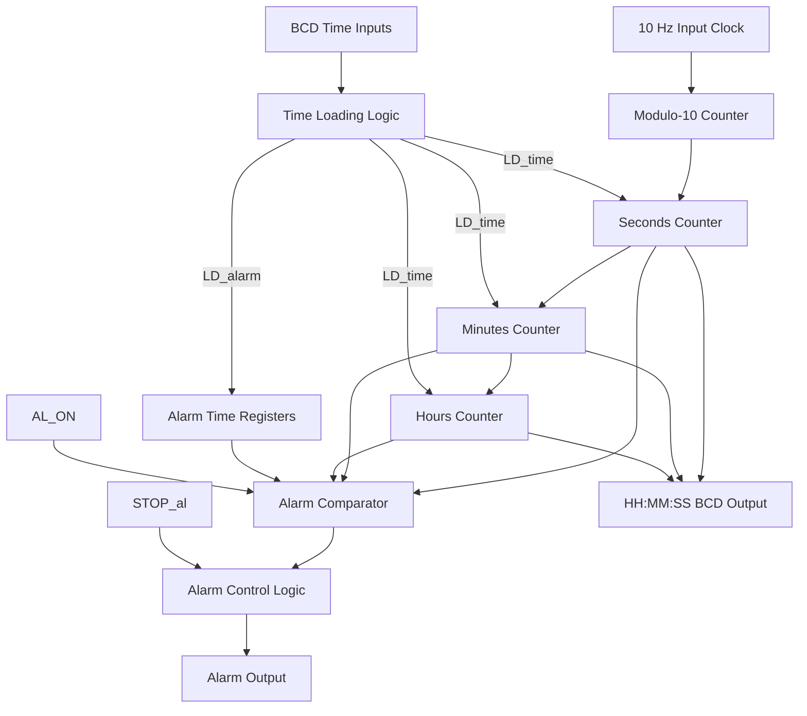

# ⏰ Digital Alarm Clock Using Verilog HDL


## 📌 Project Overview

This project presents the design and implementation of a
24-hour digital alarm clock using Verilog HDL at the
Register Transfer Level (RTL).

The system maintains time in HH:MM:SS format using
Binary-Coded Decimal (BCD) counters and provides
configurable time setting, alarm programming, alarm
activation and alarm acknowledgement functionality.

The project demonstrates fundamental digital hardware
design concepts, including sequential logic, frequency
division, cascading counters, register-based storage,
comparator logic and functional verification.

---

## 🎯 Objectives

- Implement a 24-hour digital clock using Verilog HDL.
- Design a BCD-based timekeeping architecture.
- Generate a one-second counting interval from a 10 Hz clock.
- Implement configurable alarm time registers.
- Develop alarm comparison and control logic.
- Verify clock functionality using a Verilog testbench.
- Analyze timing behavior using GTKWave.

---

## ✨ Features

- 24-hour timekeeping system.
- HH:MM:SS time representation.
- BCD-based hour, minute and second counters.
- Active-high asynchronous reset.
- Programmable current time.
- Programmable alarm time.
- Alarm enable control.
- Alarm acknowledgement control.
- Automatic midnight rollover.
- Clock cycle-based timing.
- Dedicated functional testbench.
- VCD waveform generation.

---

## 🏗️ System Architecture



The architecture consists of five major functional blocks:

| Block | Function |
|---|---|
| Clock Divider | Generates a timekeeping event every 10 clock cycles |
| BCD Counters | Maintains hours, minutes and seconds |
| Time Loading Logic | Updates the current clock time |
| Alarm Registers | Stores the programmed alarm time |
| Alarm Comparator | Detects a match and activates the alarm |

These are conceptual functional blocks implemented within
the main `aclock` RTL module.

---

## ⚙️ Technical Specifications

| Parameter | Specification |
|---|---|
| Hardware Description Language | Verilog HDL |
| Design Methodology | Register Transfer Level (RTL) |
| Top-Level Module | `aclock` |
| Testbench Module | `aclock_tb` |
| Input Clock Frequency | 10 Hz |
| Timekeeping Interval | 1 second |
| Time Format | 24-hour HH:MM:SS |
| Time Representation | Binary-Coded Decimal (BCD) |
| Hour Range | 00–23 |
| Minute Range | 00–59 |
| Second Range | 00–59 |
| Reset Type | Active-high asynchronous |
| Alarm Resolution | 1 minute |
| Simulation Tool | Icarus Verilog |
| Waveform Format | VCD |
| Waveform Viewer | GTKWave |

---

## 🔌 Module Interface

### Input Ports

| Signal | Width | Description |
|---|---:|---|
| `clk` | 1 bit | Input clock signal |
| `reset` | 1 bit | Active-high reset |
| `H_in1` | 2 bits | Hour tens digit |
| `H_in0` | 4 bits | Hour units digit |
| `M_in1` | 4 bits | Minute tens digit |
| `M_in0` | 4 bits | Minute units digit |
| `LD_time` | 1 bit | Load current time |
| `LD_alarm` | 1 bit | Store alarm time |
| `STOP_al` | 1 bit | Clear active alarm |
| `AL_ON` | 1 bit | Enable alarm triggering |

### Output Ports

| Signal | Width | Description |
|---|---:|---|
| `H_out1` | 2 bits | Current hour tens digit |
| `H_out0` | 4 bits | Current hour units digit |
| `M_out1` | 4 bits | Current minute tens digit |
| `M_out0` | 4 bits | Current minute units digit |
| `S_out1` | 4 bits | Current second tens digit |
| `S_out0` | 4 bits | Current second units digit |
| `Alarm` | 1 bit | Alarm status output |

---

## 🧠 Working Principle

### 1. Clock Frequency Division

The system receives a nominal 10 Hz input clock.

An internal modulo-10 counter counts ten rising clock
edges before advancing the time by one second.

```text
Input frequency = 10 Hz
Division factor = 10

Timekeeping frequency = 10 / 10
                      = 1 Hz
```

The design uses a clock-enable condition within the
main sequential block instead of introducing a separate
generated clock domain.

### 2. BCD Timekeeping

Each decimal digit is stored independently using BCD
representation.

For example, the time 12:34:56 is represented as:

| Digit | Decimal | Binary |
|---|---:|---|
| Hour tens | 1 | 01 |
| Hour units | 2 | 0010 |
| Minute tens | 3 | 0011 |
| Minute units | 4 | 0100 |
| Second tens | 5 | 0101 |
| Second units | 6 | 0110 |

The counters advance in the following sequence:

```text
Input Clock
     |
Modulo-10 Counter
     |
Seconds Counter
     |
Minutes Counter
     |
Hours Counter
```

BCD counters allow the time digits to be used directly
by external decimal display decoder circuits.

### 3. Automatic Time Rollover

The counting logic handles transitions between seconds,
minutes, hours and days.

```text
12:34:59 --> 12:35:00

12:59:59 --> 13:00:00

19:59:59 --> 20:00:00

23:59:59 --> 00:00:00
```

### 4. Setting the Current Time

When `LD_time` is asserted, the supplied hour and minute
digits are loaded into the time registers.

The seconds and internal clock counter are reset.

Example: Setting the clock to 06:29:00.

```text
H_in1   = 0
H_in0   = 6
M_in1   = 2
M_in0   = 9
LD_time = 1
```

### 5. Programming the Alarm

When `LD_alarm` is asserted, the hour and minute inputs
are stored in dedicated alarm registers.

These registers operate independently of the current
timekeeping registers.

Example: Programming an alarm for 06:30.

```text
H_in1    = 0
H_in0    = 6
M_in1    = 3
M_in0    = 0
LD_alarm = 1
```

### 6. Alarm Activation

The alarm comparison logic checks the following conditions:

- Alarm enable signal is asserted.
- Current hour matches the stored alarm hour.
- Current minute matches the stored alarm minute.
- Current seconds are equal to zero.

When these conditions are satisfied on a rising clock
edge, the alarm output is asserted.

```text
Current Time = 06:30:00
Alarm Time   = 06:30
AL_ON        = 1

Alarm        = 1
```

### 7. Alarm Acknowledgement

The `STOP_al` signal clears the alarm output.

The alarm output otherwise retains its previous state
until it is cleared or reset.

In the current implementation, a simultaneous alarm
match has priority over the stop condition. This behavior
is identified as an area for future refinement.

---

## 📂 Repository Structure

```text
AlarmClock-Verilog/
|
|-- alarm.v          # Main RTL implementation
|-- alarm_tb.v       # Functional simulation testbench
|-- .gitignore       # Git exclusion rules
|-- README.md        # Project documentation
```

Generated simulation files:

```text
alarm_sim            # Compiled simulation executable
aclock.vcd           # Generated waveform data
```

---

## 🛠️ Tools and Technologies

| Tool | Purpose |
|---|---|
| Verilog HDL | Hardware description and RTL design |
| Icarus Verilog | Compilation and functional simulation |
| GTKWave | Waveform visualization |
| Visual Studio Code | Source code development |
| Git | Version control |
| GitHub | Project hosting and documentation |

---

## 🚀 Getting Started

### Prerequisites

Install the following tools:

- [Icarus Verilog](https://steveicarus.github.io/iverilog/)
- [GTKWave](https://gtkwave.sourceforge.net/)
- [Git](https://git-scm.com/)
- [Visual Studio Code](https://code.visualstudio.com/)
  (optional)

Ensure that Icarus Verilog and GTKWave are available
in your system PATH.

### Step 1: Clone the Repository

```bash
git clone https://github.com/priyankardas2007/AlarmClock-Verilog.git
cd AlarmClock-Verilog
```

### Step 2: Compile the Verilog Design

```bash
iverilog -s aclock_tb -o alarm_sim alarm.v alarm_tb.v
```

### Step 3: Run the Simulation

```bash
vvp alarm_sim
```

The testbench displays the current clock time and alarm
status in the terminal.

It also generates the following waveform file:

```text
aclock.vcd
```

### Step 4: Visualize the Waveforms

```bash
gtkwave aclock.vcd
```

Add the relevant clock, time, reset and alarm signals
to the GTKWave waveform viewer.

---

## 🧪 Functional Verification

The testbench uses directed test scenarios to examine
the functional behavior of the RTL design.

| Test | Scenario | Expected Behavior |
|---|---|---|
| TC01 | Reset | Initialize time to 12:34:00 |
| TC02 | Normal counting | Advance the clock |
| TC03 | Load current time | Set time to 23:59:00 |
| TC04 | Program alarm | Store alarm time as 00:00 |
| TC05 | Enable alarm | Allow alarm triggering |
| TC06 | Midnight rollover | Transition to 00:00:00 and trigger alarm |
| TC07 | Stop alarm | Clear active alarm |
| TC08 | Load new time | Set time to 06:29:00 |
| TC09 | Program new alarm | Trigger alarm at 06:30 |

### Simulation Timing

The testbench uses an accelerated simulation clock
with a period of 10 ns.

```text
Clock period                  = 10 ns
Clock cycles per clock second = 10
Simulated timekeeping second  = 100 ns
```

This allows clock transitions to be examined without
waiting for real-world time intervals.

The current testbench uses monitored outputs and
directed stimulus. Expected results should be checked
against the simulation log and generated waveforms.

---

## 📊 Waveform Analysis

The following signals can be examined using GTKWave:

- Input clock and reset.
- Internal clock counter.
- Hour, minute and second registers.
- Current time loading signal.
- Alarm loading signal.
- Alarm enable signal.
- Alarm acknowledgement signal.
- Alarm output.

The waveform analysis is intended to demonstrate:

- Correct BCD counter transitions.
- One-second counting intervals.
- Minute and hour rollover.
- Midnight rollover.
- Alarm time matching.
- Alarm acknowledgement.

---

## 📚 Engineering Concepts Demonstrated

This project provides practical exposure to:

- Register Transfer Level (RTL) design.
- Sequential digital logic.
- Synchronous counters.
- Binary-Coded Decimal arithmetic.
- Frequency division and clock enables.
- Register-based data storage.
- Digital comparator circuits.
- Non-blocking assignments.
- Asynchronous reset logic.
- Hardware Description Languages.
- Functional verification.
- Timing waveform analysis.
- Git-based hardware development workflows.

---

## ⚠️ Current Limitations

- The design assumes a nominal 10 Hz input clock.
- Invalid BCD time inputs are not explicitly rejected.
- Alarm acknowledgement can be overridden by an active
  time-match condition.
- Disabling `AL_ON` prevents new alarm triggers but does
  not automatically clear an already active alarm.
- The testbench does not yet contain automated assertions.
- FPGA synthesis and physical hardware validation have
  not been documented.

---

## 🔮 Future Enhancements

- [ ] Parameterizable input clock frequency.
- [ ] Automated self-checking testbench.
- [ ] Input time validation.
- [ ] Improved alarm acknowledgement priority.
- [ ] Snooze functionality.
- [ ] Multiple programmable alarms.
- [ ] 12-hour and 24-hour mode selection.
- [ ] Seven-segment display controller.
- [ ] Push-button debouncing.
- [ ] FPGA synthesis and timing analysis.
- [ ] FPGA-based hardware implementation.
- [ ] Automated simulation using GitHub Actions.

---

## 🌐 Potential Applications

- FPGA-based digital clocks.
- Embedded timing systems.
- Programmable alarm systems.
- Digital scheduling circuits.
- Hardware timer peripherals.
- Educational digital electronics platforms.
- RTL design and verification projects.

---

## 👨‍💻 Author

**Priyankar Das**

B.Tech — Electronics and Telecommunication Engineering

Army Institute of Technology, Pune

Areas of Interest:

- VLSI Design
- Digital Hardware Design
- RTL Design and Verification
- FPGA Development
- Embedded Systems
- Semiconductor Technology

GitHub: [priyankardas2007](https://github.com/priyankardas2007)

---

## ⭐ Support

If you find this project useful, consider starring the
repository.

Feedback and suggestions for improving the hardware
architecture and verification methodology are welcome.

---

<p align="center">
  Developed with Verilog HDL | Digital Design | RTL Engineering
</p>
